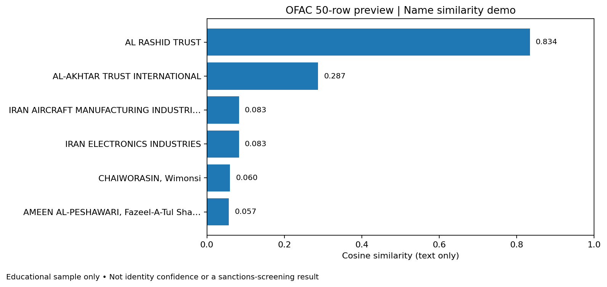

# OFAC SDN Preview — Real ML Name-Similarity Demonstration

**IT Altitudes Inc. | Educational demonstration only**

This reproducible example fits a **TF-IDF character n-gram vectorizer** and a **Nearest Neighbors** model to **50 SDN primary names** in the free buyer preview. It finds names that are textually similar to an input query.

## Actual sample demonstration

- **Rows indexed:** 50 primary SDN records
- **Query:** `ALRASHIDTRUST` (deliberately removes spaces from a name already in the preview)
- **Top result:** `AL RASHID TRUST` (Entity_ID `6912`), cosine similarity **0.8341**
- **Second result:** `AL-AKHTAR TRUST INTERNATIONAL`, similarity **0.2869**
- **Output:** `ofac_name_similarity_results.csv`



## Run it

Install Python 3.9+ and run:

```bash
pip install pandas scikit-learn
python ofac_name_similarity_demo.py
```

The script reads `ofac_primary_50.csv`, fits the model, and writes a new results CSV. You can change `query` in the script to test another name.

## Files

- `ofac_primary_50.csv` — 50-row preview subset (ID, name, type, program)
- `ofac_name_similarity_demo.py` — reproducible Python training and retrieval
- `ofac_name_similarity_results.csv` — actual model output
- `ofac_name_similarity_chart.png` — visualization of top matches

## Limitations and safety

- This is a **text similarity model**, not a classifier that predicts whether a person or organization is sanctioned.
- Similarity scores are **not probabilities of identity** and have no validated threshold.
- A name match does not prove identity; a non-match does not establish unrestricted status.
- The 50-row sample is selected, limited, and not representative of the full OFAC list.
- This is **not** a sanctions-screening, clearance, compliance, or legal decision system. Consult current official OFAC sources and qualified compliance professionals for operational use.
- The example uses primary names only. It does not evaluate addresses, aliases, dates of birth, or other disambiguating information.

[Explore the GitHub preview](https://github.com/ITAltitudesDataset/ofac-sanctions-dataset-sample) | [Complete dataset information](https://italtitudes.gumroad.com/l/zkltfw)
